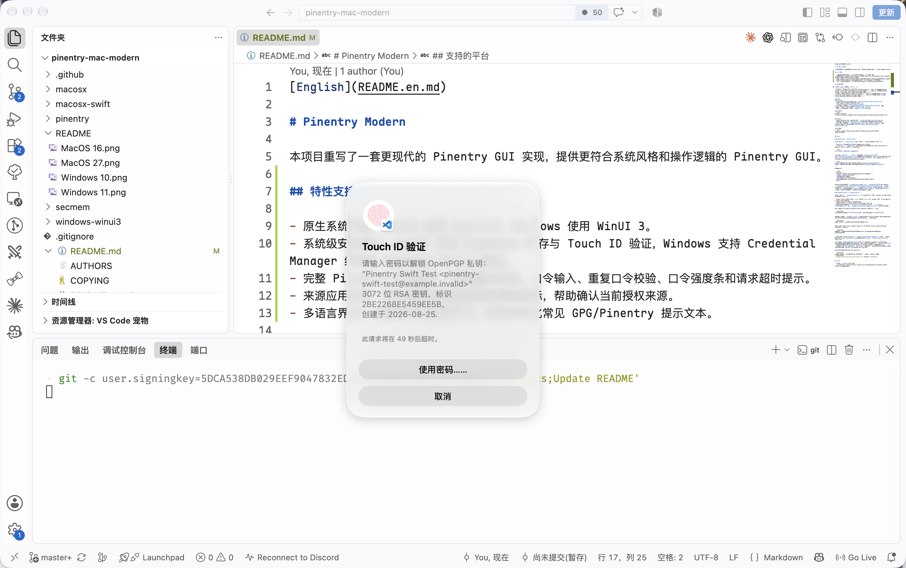

[English](README.en.md)

# Pinentry Modern

本项目重写了一套更现代的 Pinentry GUI 实现，提供更符合系统风格和操作逻辑的 Pinentry GUI。

## 特性支持



- 原生系统界面：macOS 使用 SwiftUI，Windows 使用 WinUI 3。
- 系统级安全能力：macOS 支持 Keychain 缓存与 Touch ID 验证，Windows 支持 Credential Manager 缓存与 Windows Hello 验证。
- 完整 Pinentry 对话能力：支持确认对话、口令输入、重复口令校验、口令强度条和请求超时提示。
- 来源应用识别：尽可能显示发起请求应用的图标，帮助确认当前授权来源。
- 多语言界面：内置英文和简体中文，并会本地化常见 GPG/Pinentry 提示文本。

## 支持的平台

| 平台 | 最低兼容版本 | 截图 |  |
| ----- | ----- | ----- | ----- |
| Windows | Windows 10 <small>10.0.17763.0</small> |  |  |
| MacOS | MacOS Ventura <small>13.0</small> |  |  |

## 安装
### Windows
- 从仓库 Releases 下载安装程序：```pinentry-modern-setup-<version>.exe```
- 安装 Pinentry Modern，默认安装位置位于：```%AppData%\Local\Programs\pinentry-modern```
- 修改 gpg 配置文件 `~/.gnupg/gpg-agent.conf`，将 `pinentry-program` 指向 Pinentry Modern 安装目录下的 `pinentry-modern.exe`。
- 重新加载 gpg-agent 配置：```gpgconf --kill gpg-agent```

示例配置：
```text
pinentry-program C:\Users\<username>\AppData\Local\Programs\pinentry-modern\pinentry-modern.exe
```

### MacOS
- 从仓库 Releases 下载 app 压缩包：```pinentry-modern-<version>.app.zip```
- 解压后将 app 移动到 `/Applications` 目录下，或任意你可以找到的位置。
- 修改 gpg 配置文件 `~/.gnupg/gpg-agent.conf`，将 `pinentry-program` 指向 Pinentry Modern 安装目录下的 `pinentry-modern.app/Contents/MacOS/pinentry-modern`。

示例配置：
```text
pinentry-program /Applications/pinentry-modern.app/Contents/MacOS/pinentry-modern
```

## 构建

### macOS Swift (`macosx-swift`)

Swift 版本位于 `macosx-swift`，最低部署目标为 macOS 13。构建前请准备：

- Xcode 14.1 或更新版本，并安装 Command Line Tools。
- `libassuan` 和 `libgpg-error` 的头文件与动态库。可以安装 [GPG Suite](https://gpgtools.org/)，也可以使用 Homebrew：

```shell
brew install libassuan libgpg-error
```

仓库内的 `pinentry` 和 `secmem` C 代码会由 `macosx-swift/Scripts/build-pinentry-core-libs.sh` 自动编译成静态库，不需要单独安装 `secmem`。构建脚本会优先查找 `/usr/local/MacGPG2`、`/opt/homebrew`、`/usr/local` 以及 Homebrew 的 `opt` 路径；如果依赖安装在自定义目录，请显式指定：

```shell
export PINENTRY_MAC_SWIFT_ASSUAN_PREFIX="/path/to/libassuan/prefix"
export PINENTRY_MAC_SWIFT_GPG_ERROR_PREFIX="/path/to/libgpg-error/prefix"
```

调试构建：

```shell
xcodebuild \
  -project "macosx-swift/pinentry-mac-swift.xcodeproj" \
  -scheme "pinentry-mac-swift" \
  -configuration Debug \
  -destination "platform=macOS" \
  -derivedDataPath /private/tmp/pinentry-mac-modern-build \
  build
```

Release 构建只需要把 `-configuration Debug` 改为 `-configuration Release`。产物位于 `DerivedData` 的 `Build/Products/<Configuration>/pinentry-modern.app` 中；构建阶段会把 `libassuan.0.dylib` 和 `libgpg-error.0.dylib` 打包到 app 的 `Contents/Frameworks` 目录里。不要把 `Contents/MacOS/pinentry-modern` 从 app bundle 中单独拿出来运行，否则本地化资源和打包的动态库可能无法被找到。

### Windows WinUI 3 (`windows-winui3`)

WinUI 3 版本位于 `windows-winui3`，使用 C++/WinRT，目标平台为 Windows 10 1809 或更新版本。构建前请准备：

- Visual Studio 2022，安装“使用 C++ 的桌面开发”和“通用 Windows 平台开发”工作负载，包含 MSVC v143 工具集。
- Windows SDK 10.0.22621.0 或更新版本。
- NuGet CLI，或使用 Visual Studio 自带的 NuGet 包还原。
- Gpg4win。工程默认从 `C:\Program Files\Gpg4win\include` 和 `C:\Program Files\Gpg4win\lib` 查找 `libgpg-assuan.imp`、`libgpg-error.imp` 以及对应头文件。

如果 Gpg4win 或 GnuPG 依赖安装在自定义位置，请在 MSBuild 中传入：

```powershell
/p:AssuanIncludeDir="C:\Path\To\include" /p:AssuanLibDir="C:\Path\To\lib"
```

首次构建前先还原 `packages.config` 中声明的 NuGet 包，包括 Windows App SDK、Windows App SDK WinUI、C++/WinRT、Windows SDK BuildTools 和 WebView2：

```powershell
nuget restore .\windows-winui3\PinentryModern.sln
```

然后在“x64 Native Tools Command Prompt for VS 2022”或 Visual Studio Developer PowerShell 中构建：

```powershell
msbuild .\windows-winui3\PinentryModern.sln /p:Configuration=Release /p:Platform=x64
```

也可以直接用 Visual Studio 打开 `windows-winui3/PinentryModern.sln`，先执行 NuGet Restore，再选择 `Release|x64` 构建。Release 输出目录为 `windows-winui3/bin/x64/Release`。

工程设置了 `WindowsAppSDKSelfContained=true`，Release 目录会包含 WinUI/Windows App SDK 的本地依赖文件；请保持整个输出目录一起分发，不要只复制 `pinentry-modern.exe`。运行时还需要系统已安装 Microsoft Visual C++ Redistributable x64。Gpg4win 的 `libgpg-assuan`、`libgpg-error` 运行时 DLL 也需要能被加载到：可以保持 Gpg4win 的默认安装路径，或将所需 DLL 放到 Release 输出目录中。

构建安装包需要额外安装 Inno Setup 7：

```powershell
winget install --id JRSoftware.InnoSetup.7 --exact --source winget --interactive
.\windows-winui3\Tools\build-installer.ps1 -Version "<version>"
```

## 感谢

- 本项目使用 GPT 5.5 辅助完成
- 感谢 [pinentry-touchid](https://github.com/jorgelbg/pinentry-touchid) 项目对 Touch ID 相关功能的灵感
